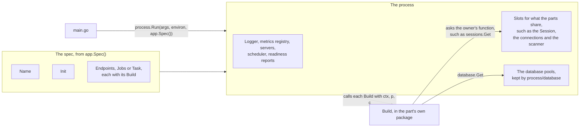

# 0142. Each program is a spec that lists what it is made of, and one process runs it, keeping what its endpoints and jobs share

**Status:** Accepted (supersedes [ADR-0138](./0138-one-host-runs-each-process-and-each-component-provides-its-parts.md)) ·
**Pillar:** [Concerns stay un-braided; components know only their contracts](../../../DESIGN.md#concerns-stay-un-braided-components-know-only-their-contracts) ·
**Serves:** [O3](../../../USE_CASES.md#o3--survives-its-failure-modes),
[O2](../../../USE_CASES.md#o2--observable),
[O6](../../../USE_CASES.md#o6--deployable)

## Context

The API server, the UI, the worker and the migrator each run as a process, and each process needs
the same work done around what its program does. It reads and checks its configuration, sets up
its logs and metrics, tells the platform whether it is ready, serves requests or runs jobs, and
stops in order. Where each program writes that work itself, each copy is a place a rule can be
left out. A copy that leaves out readiness leaves the platform unable to tell when the process can
serve. A copy that starts a goroutine without recovering and joining it can lose a panic, or close
a pool while the goroutine still uses it. A test or a harness that puts a program together by hand
runs something other than the program, and misses the operation timing or the connection limits
the program applies.

The parts of one program also share things. The API server's two endpoints share one registry of
operations. Every endpoint and job kind that works on accounts shares the accounts, their policy,
their credentials and the scanner. Where each program builds these in its own entry code, each
builds them its own way and at its own depth, the loading of the accounts, their credentials and
their policy is written once per program, and behaviour gathers in the entry code. Where a shared
thing is built by whichever part asks for it first, its log labels, its metric labels and the
settings it reads depend on the order the parts are built in.

Some checks belong to the whole program rather than to one of its parts. The MCP SDK reads
`MCPGODEBUG` when the process starts, so the API server has to refuse it before anything serves
([ADR-0086](./0086-mcp-root-on-the-official-go-sdk.md)).

[ADR-0040](./0040-pure-core-decisions-as-values.md) wants the wiring in ordinary code a reader can
follow, with nothing resolved at run time by registry, reflection, annotation or naming convention.
[ADR-0050](./0050-shared-code-pure-or-narrow.md) puts what several programs would otherwise repeat
in the library of its concept. [ADR-0051](./0051-environment-contract.md) keeps a program ignorant
of its platform, and the same un-braiding asks that what a program is made of stay ignorant of the
process it runs in.

## Decision

### The two things, and how they meet

A **spec** is what one program is made of. It lists the program's name, a check to run at start,
and the program's endpoints, its job kinds or its one task, each with the function that builds it.
It does nothing itself.

A **process** is one running program. It takes one spec, builds every part the spec lists, keeps
the things those parts share, serves the endpoints or runs the job kinds or the task, reports
whether it is ready, and stops in order. It does this the same way whichever program it runs.

Both live in the process family, `process`.



| | The spec | The process |
| --- | --- | --- |
| Is | What one program is made of | One running program |
| Holds | Its name, its start check, and its endpoints, its job kinds or its one task, each with the function that builds it | The loaded configuration and the database pools. The logger, the metrics registry, the servers, the scheduler and the readiness reports. All the user state, the Session. And anything else an owner package keeps in it |
| Does | Nothing. It lists | Starts, loads the configuration, calls each function in the spec, serves, runs the jobs, answers the probes from what was reported, and stops in order |
| Hands on | How each endpoint, job kind or task is built, to that part's own package | What an endpoint or a job kind does, to its package. User state, to the Session. Calls to a provider, to the provider library through the connections. The shape of the configuration, to `core/config` |
| Knows nothing of | The process it will run in, or what else runs there | Accounts, providers, policies, or any one program |

### The spec

- **A spec lists, and builds nothing.** Its type is `process.Spec[C]`, where `C` is the program's
  configuration type.

  ```go
  process.Spec[C]{
      Name      string                                  // "api". The program's directory, and its component label
      Init      func(args, environ []string, c C) error // the start check. May refuse to start. Builds nothing
      Endpoints []Endpoint[C]                           // what it serves over HTTP, each at its pattern
      Jobs      []Job[C]                                // its job kinds, each run on a schedule
      Task      *Task[C]                                // set instead, for a program that does one piece of work and exits
  }
  ```

  | Program | What its spec lists |
  | --- | --- |
  | The API server | The endpoints `/api/` and `/mcp`, and `Init`, which refuses `MCPGODEBUG` |
  | The UI | The endpoints `/ui/api/`, `/ui/` and `/{$}`, the last of which redirects to `/ui/` ([ADR-0137](../operability/0137-the-top-level-paths-are-the-surfaces-and-the-ui-serves-under-ui.md)) |
  | The worker | The job kinds backfill and delta sync, and each job kind growth adds ([ADR-0117](../operability/0117-one-background-worker-runs-every-job-kind.md)) |
  | The migrator | One task, which applies the migration chain ([ADR-0139](../data/0139-the-migration-runner-is-goose-linked-into-the-migrator.md)) |

- **A program's `main.go` is one call**, `process.Run(os.Args[1:], os.Environ(), app.Spec())`. It
  hands the process its arguments, its environment and its spec, since only a `main.go` may read
  the environment ([ADR-0078](./0078-configuration-layers-through-an-owned-library.md)).
  `process.Run` always takes one spec. A program's entry package, `<program>/app`, holds its spec
  and nothing else.
- **A spec belongs to a deployable or to the migrator.** The command-line program, which an
  operator runs by hand, has no spec and runs no process.
- **`Init` checks, refuses and builds nothing.** It is given what `process.Run` was given and the
  loaded configuration, and returns only an error. So a program can refuse to start there and
  cannot build anything there. The API server's `Init` refuses `MCPGODEBUG`
  ([ADR-0086](./0086-mcp-root-on-the-official-go-sdk.md)).

### Building a part

- **An endpoint, a job kind and a task are each built by one function of their own package, and
  all three are built the same way.** That function, `Build`, runs while the process is being
  built. It returns what runs later, an endpoint's handler, a job kind's plan for the scheduler, or
  a task's work.

  ```go
  Endpoint.Build func(ctx context.Context, p process.Capabilities, c C) (http.Handler, error)
  Job.Build      func(ctx context.Context, p process.Capabilities, c C) (schedule.Plan, error)
  Task.Build     func(ctx context.Context, p process.Capabilities, c C) (func(context.Context) error, error)
  ```

  | Parameter | What it is |
  | --- | --- |
  | `ctx` | The context a build may use, such as to open a pool |
  | `p` | What the process offers the one part being built, below |
  | `c` | The program's whole configuration, of which the part reads what it needs |

  The parameters are fixed by the spec's type, which the compiler holds, so no `Build` can be
  handed anything else. What is fenced is the code that acts on a setting, by the import lists
  ([ADR-0071](./0071-static-enforcement-toolchain.md)), not the setting.
- **`p` is the process's offer to the part being built**, the interface `process.Capabilities`.

  ```go
  type Capabilities interface {
      Logger() *slog.Logger                           // the process's logger, with the part's labels
      Metrics() prometheus.Registerer                 // a registerer of the process's one registry, with the same labels
      Report(state State, reason string)              // ready, not ready, or failed
      Go(name string, run func(context.Context)) bool // a goroutine the process waits for
      Draining() context.Context                      // ends when the process starts to stop
  }
  ```

  The labels are `component`, the program's name, and `job_kind` for a job kind. Every endpoint
  carries the same label names as every other, and every job kind the same as every other, so two
  endpoints or two job kinds may register one series name. Once the
  process has begun to wait for its goroutines at stop, `Go` starts nothing and returns false. `p`
  also carries, unexported, the process it belongs to, which is how an owner's function finds the
  thing it keeps in the process.
- **Everything is asked for and built while the process is being built, and the scheduler and the
  servers start after.** A `Build` may read what it needs to be built, and fails when that cannot
  be read, so a process that cannot be built never serves. No `Build` starts a goroutine of its own
  or registers a route on a mux it is handed.
- **Which helper starts a goroutine depends on whose code starts it.**

  | Code | Starts a goroutine only through | What a panic on it does |
  | --- | --- | --- |
  | The worker's job code | The scheduler's helper, `schedule.Go` ([ADR-0119](../operability/0119-the-workers-jobs-are-scheduled-from-recorded-state.md)) | Fails that job's run and stops nothing else |
  | The API server's and the UI's code, and a thing the process shares, such as the policy load that concurrent body requests share | `p.Go` | Fails what started it, which stops the process in order |

  A job's panic stays that run's failure, so one job kind's fault never stops the others
  ([ADR-0117](../operability/0117-one-background-worker-runs-every-job-kind.md)). A job kind's
  `Build` is handed `p` as every `Build` is, and a panic on a goroutine `p.Go` started stops the
  process, so the worker's job code starting one through `p.Go` rather than `schedule.Go` is held
  by review, since no analyser refuses a call of either helper. The process runs what `p.Go` starts
  under the jobs' context, and waits for it before the slots are closed.

### What the process keeps for the parts

- **The process keeps what its endpoints and job kinds share.** Each endpoint and job kind is built
  by its own function, called separately, so when two need the same object something has to keep
  it between the two calls. That place is a slot, `process.OnePerProcess[T]`, which one owner
  package declares once. The owner exports one function, which takes the build's context first and
  returns what the owner keeps.

  | Shared thing | How many a process holds | Owner package | Its function |
  | --- | --- | --- | --- |
  | The scheduler | One | `process/schedule` | Used by the process for the spec's job kinds, and by an owner for its own upkeep |
  | The Session | One | `process/sessions` | `sessions.Get(ctx, p, c)` |
  | Each account's connection to its provider | One set, a record per account | `process/connections` | `connections.Of(ctx, p, c, s)` |
  | The scanner | One | `process/scanner` | `scanner.Get(ctx, p, c)` |
  | The API server's registry of operations | One, in the API server | `api/internal/registry` | `registry.Get(ctx, p, c)` |
  | The UI's checks and their key | One, in the UI | `ui/internal/server` | `server.Get(ctx, p, c)` |

  The first call of an owner's function builds its thing under the slot's lock, and every later
  call returns the same one. Nothing is looked up by type, name or reflection, so nothing
  resolves by registry, reflection, annotation or naming convention, as
  [ADR-0040](./0040-pure-core-decisions-as-values.md) requires. The process closes what it keeps,
  last built first, once the servers have drained and the jobs have ended.
- **A process holds one or more database pools, and in the worker each job kind has a pool of its
  own**, so one job kind cannot starve another of connections
  ([ADR-0119](../operability/0119-the-workers-jobs-are-scheduled-from-recorded-state.md)). A job
  kind's code runs on its own pool, whose series carry that job kind's label as well as the
  program's. Every pool is `process/database`'s, which keeps the pools a process holds apart from
  the slots above. A part asks for its pool through `database.Get(ctx, p, c)`, and the migrator's
  task through `database.ForMigration(ctx, p, c)`, which is the migrator's alone. The process closes
  the pools with what the slots hold. `database.Get` reads from `p` whether the part being built is
  a job kind. A job kind's part gets the job kind's own pool, and every other part, and a thing the
  process shares, gets the process's one pool, each opened from the one database part.
  `database.ForMigration`, which opens the migrator's pool with no schema check, takes a
  configuration type that has an unexported method only `config.Migrator` has, so the compiler
  refuses a deployable's own configuration there. Left to review are a `Build` that makes a
  `config.Migrator` value of its own, by a literal, by its defaults or as a zero value, and, until
  `process/host` is deleted, the lower-level opening the host opens its pools through, which runs
  no schema check, and a pool a deployable's code opens through the driver itself. A pool apart for
  a later need is a further function of `process/database`.
- **The spec and each `Build` are the program's wiring**, written by hand in ordinary code, as
  [ADR-0040](./0040-pure-core-decisions-as-values.md) requires. The order the parts start in is the
  stages below. A part's pool comes from `process/database`, and the API server, the UI and the
  worker connect as the one application user
  ([ADR-0143](../data/0143-the-programs-connect-as-one-application-user-beside-the-migrators.md)).
- **A thing the whole process shares is built from the process, never from whoever asked first.**
  What it registers, logs and reports must not depend on which endpoint or job kind asked first.
  So each owner of the scheduler, the Session, the connections, the scanner and every pool that is
  not a job kind's own builds it with the process's own logger and registerer, labelled with the
  program's name and no job kind, and reports its readiness under its own name. A job kind's pool
  is built for the job kind that runs on it and labelled with that job kind. A pool that is not a
  job kind's follows the rule of no job kind like every other shared thing, so its series carry no
  `job_kind`. Every pool's series register unchecked, as
  [ADR-0125](./0125-performance-is-measured-once-at-each-place-time-goes.md) states, so they share one registry with a job kind's pool's series,
  which carry its `job_kind`. A shared thing reads
  the shared parts of the configuration, the parts every program that has them holds under the
  same keys ([ADR-0078](./0078-configuration-layers-through-an-owned-library.md)). Where it needs
  the revision of its settings, the digest the configuration library computes for each top-level
  key, it reads it from the process, which holds what the library returned. Go cannot stop a build
  function from using a variable of whoever asked, so this rule is held by review.
- **The API server's registry and the UI's checks are built with the labels of whichever endpoint
  asks first.** Each is one program's own, asked for only by that program's endpoints, which all
  carry that program's labels.
- **A configuration type that lacks a part cannot ask for what is built from it.** `c` must have
  the part the owner reads, which the compiler checks through `config.HasDatabase`,
  `config.HasAccounts` and `config.HasConnections`. The UI's type has no accounts part, so the UI
  cannot ask for the Session or the connections.
- **The Session is the process's.** All the user state a process holds is one thing, the Session.
  It holds the accounts, each account's policy and each account's connection to its provider, and
  owns their reload, which runs on the interval `account_reload_interval` sets
  ([ADR-0090](../operability/0090-accounts-reach-deployables-as-reloaded-snapshots.md)). The first
  reload does not hold up the start. Until a reload has loaded the list, the connections where the
  process has them, and the policy, the Session reports not ready and the reload is tried again. The
  UI never holds the Session.

### What the process does, start to stop

A process that runs until it is told to stop goes through four stages. Each row lists what the
process does in that stage, for every program.

| Stage | What the process does |
| --- | --- |
| Start | Sets up its logs, loads and checks the configuration, and announces itself, in the steps listed below the table |
| Build | Builds the process's one metrics registry and registers the runtime series once. Calls each `Build` in the spec, handing each a registerer that labels every series it registers. Opens each pool when its owner's function is first called. In a process that runs until it is told to stop, `database.Get` runs the schema check on each pool before returning it, so a schema the process cannot run on stops the start before anything serves ([ADR-0140](../data/0140-each-migration-declares-the-oldest-chain-that-runs-on-it.md)) |
| Run | Serves `/healthz`, `/readyz` and `/metrics` on the probe listener as plain text. The probes answer from what was reported and run nothing. `/readyz` answers 200 only while the process serves and everything that reports is ready, and names the first that is not. Serves the application server on one listener, with TLS when the configuration names a key pair, which is loaded before anything is served ([ADR-0127](../operability/0127-tls-when-given-a-key-pair-plain-http-otherwise.md)), mounting each endpoint's handler at its pattern and serving nothing else. Runs every job kind's plan on the process's scheduler, which recovers a panic in each run as that run's failure ([ADR-0119](../operability/0119-the-workers-jobs-are-scheduled-from-recorded-state.md)) |
| Stop | Begins when the process is told to stop, when a server fails, or when a goroutine started through `Go` panics. A job's failure fails its run and stops nothing else, and a listing that fails is asked again after its backoff ([ADR-0119](../operability/0119-the-workers-jobs-are-scheduled-from-recorded-state.md)), so the scheduler has no failure of its own while it runs. A plan the scheduler refuses fails the start before anything serves. Answers not ready, ends what `Draining` returned, drains the application server's requests for ten seconds, ends the jobs' context and waits for every job and every started goroutine. Then stops the operations server and closes what the slots hold |

The start, in order.

1. Builds the logger and its level before the configuration exists, so a start that fails before
   its level is read still reports its error as JSON
   ([ADR-0122](./0122-logs-through-slog-at-a-configured-level-handed-to-shells.md)).
2. Refuses to start while the database driver's password variables, `PGPASSWORD` and
   `PGSSLPASSWORD`, are set, since a stray one would win over the mounted password file
   ([ADR-0078](./0078-configuration-layers-through-an-owned-library.md),
   [ADR-0139](../data/0139-the-migration-runner-is-goose-linked-into-the-migrator.md)).
3. Loads one configuration tree through the configuration library into the program's
   configuration type, and answers `--help` and `--version` on standard output.
4. Logs every effective value, then sets the level the configuration names.
5. Runs the configuration type's checks, then the spec's `Init`.
6. Writes the start banner to standard error.

- **A program that does one piece of work and exits is run by the process too, through its task.**
  The process goes through the same start and builds the registry, and calls the task's `Build`
  as it calls every `Build`. It serves no operations endpoints and no application server and runs
  no job, since nothing probes, scrapes or calls a program that exits on its own. It returns the
  work's error once every goroutine the work started has returned and the slots are closed. The
  migrator is that program
  ([ADR-0139](../data/0139-the-migration-runner-is-goose-linked-into-the-migrator.md)).
- **What each program reports as ready.**

  | Program | Ready when |
  | --- | --- |
  | The API server | Its bearer token file holds a token, and the Session has loaded the accounts, their connections and their policy once ([ADR-0090](../operability/0090-accounts-reach-deployables-as-reloaded-snapshots.md)) |
  | The UI | The database answers a ping |
  | The worker | Each job kind's pool answers a ping, the Session has loaded the accounts, their connections and their policy once, and each job kind's first listing of what it runs for has succeeded ([ADR-0119](../operability/0119-the-workers-jobs-are-scheduled-from-recorded-state.md)) |

- **The UI's event stream ends when draining begins**, through the context `Draining` returns. So
  a stopping process drains its other requests rather than waiting out an answer that never ends. A
  request's own context ends once the jobs are told to stop, after the drain.

### Tests, and where a rule binds

- **A test hands the process a shared thing it made through one seam.** A test or a harness runs a
  program through its spec and `process.RunContext`, which runs it as `process.Run` runs it for
  `main.go`, until a context it is given ends, and returns the run's error rather than exiting.
  Where it needs to substitute a
  shared thing, such as connections over the provider fake, it hands the process that thing
  through the one option the owner exports for it, which fills the owner's slot before anything
  asks. So what a test runs is what the program runs, apart from what the test handed in.
- **A restriction a record puts on a process or a program binds the code area it names, however
  that code is packaged.** Where a record names a program for a rule about its code, its import
  list, its pools, its goroutines or its series, the rule holds for that program's code in any
  process that runs it.

## Alternatives considered

- **One host that runs each process over the components a hand-written root per program hands
  it.** The case for it is that the process's work has one home while each root keeps its own
  choice of pieces, pools and start order in its own code. Not chosen, because behaviour gathers in
  the roots, each builds the shared things its own way and at its own depth, and the loading of
  the accounts is repeated in each root that needs it. A spec that only lists, with each shared
  thing built by its one owner, leaves no root for behaviour to gather in.
- **Each program writing the process's work itself.** The case for it is that each program's entry
  code reads top to bottom with nothing hidden. Not chosen, because each copy drifts on its own, in
  readiness, key-pair loading, goroutine recovery and the harnesses, and every rule a copy encodes
  is one a further program would have to copy again.
- **An application framework that owns the lifecycle and the wiring.** The case for it is a
  lifecycle written and tested elsewhere, with hooks for start and stop. Not chosen, because
  [ADR-0040](./0040-pure-core-decisions-as-values.md) refuses a framework that owns the object
  graph. The process owns only what every program does, and each shared thing is built by its
  owner in ordinary code.
- **Shared things looked up in a map keyed by their type.** The case for it is one generic
  mechanism and no declaration per owner. Not chosen, because
  [ADR-0040](./0040-pure-core-decisions-as-values.md) forbids resolving by registry, reflection,
  annotation or naming convention, and a slot named in code is none of those. The cost is one
  exported option per owner for tests.
- **A spec that also lists what each part needs, with helper functions pairing a constructor with
  its settings and the shared things it uses.** The case for it is that the compiler then refuses a
  part's read of settings it did not declare and its use of a shared thing it did not ask for. Not
  chosen, because a spec that names a database user breaks the rule that a program does not name
  its database user, and the operator found neither the list of needs in the spec nor the helper
  functions readable. A `Build` that takes the whole configuration, with the code that acts on a
  setting fenced by the import lists, holds the same with named fields only.
- **A shared thing built through the endpoint or job kind that first asks for it.** The case for
  it is one less parameter to carry. Not chosen, because the first asker's labels and settings
  would then win, so what the thing registers and logs would depend on build order.
- **A goroutine or a loop an endpoint or job kind starts itself, or routes it registers on a mux
  it is handed.** The case for it is fewer values passed back. Not chosen, because the routes
  analyser holds the UI's routes to its recording mux, and a goroutine started outside `p.Go`, or
  outside `schedule.Go` in the worker's job code, is one the process can neither recover nor join.
- **The `component` label applied by each program's code.** The case for it is that each program's
  series name their owner without the process. Not chosen, because a program would then know how it
  is packaged, and a series would take its shape from whoever wrote the code rather than from one
  rule.

## Consequences

- One rule set runs every program. A probe, a limit, a stop order or a refusal changes in one
  place, and a new program gets all of them by writing a spec.
- Each thing the parts share is built once per process, by one owner, in one way, whichever
  program asks. A new job kind or endpoint that needs the Session or the scanner calls the owner's
  function, one that needs a pool asks `process/database`, and none builds anything of its own.
- Every `Build` takes the same parameters, the build's context, `p` and `c`, fixed by the spec's
  type. So what an endpoint's or a job kind's code can reach is its parameters and its import list,
  and no program's code can hand one an extra input
  ([ADR-0117](../operability/0117-one-background-worker-runs-every-job-kind.md)).
- Every series an endpoint or job kind registers carries `component`, and the worker's job kinds
  carry `job_kind` beneath it. Every endpoint carries the same label names as every other, and every
  job kind the same as every other, so two endpoints or two job kinds may register one series name.
  The pools' series register unchecked, so a job kind's pool's, which carry `job_kind`, and those of
  a pool that is no job kind's, which carry none, share one registry
  ([ADR-0125](./0125-performance-is-measured-once-at-each-place-time-goes.md)).
- No goroutine of a program's code loses a panic or outlives the slots. The `go vet` goroutines
  analyser refuses, in a non-test file under `api/`, `ui/` or `worker/`, a `go` statement and any
  use of a function that starts a goroutine running what it is given, so that code starts one only
  through a helper that recovers it. Which helper is held by review, `p.Go` in the API server's and
  the UI's code and `schedule.Go` in the worker's job code
  ([ADR-0119](../operability/0119-the-workers-jobs-are-scheduled-from-recorded-state.md)). The
  analyser does not read the process family's own code, so a shared thing's goroutine is held to
  the process's `Go` by review.
- The API server starts while its first reload of the accounts has not succeeded, and reports not
  ready until one has. The worker answers readiness, so the chart can probe it.
- The probes carry no content security policy. They are plain text for a platform's healthcheck
  and scraper, and the UI's policy stays on every response of its own
  ([ADR-0062](../operability/0062-ui-content-security-policy.md)).
- The UI is served under the same connection limits as the API server, a read limit of 30 seconds
  among them, which bounds reading a request and never an answer, so an event stream is not cut
  ([ADR-0130](../operability/0130-the-api-server-bounds-what-one-request-can-make-it-hold.md)).
- The browser bundle is embedded by a package of its own beside it, `ui/browser`, which the
  package serving the UI's pages, `ui/internal/pages`, imports.
- A program hosting several programs' endpoints and job kinds is a program like the others, with
  a spec of its own that joins theirs. How its series are labelled and its keys laid out are
  decided when it is built.
- Assumptions about other components. Each `Build` reads what it needs from its parameters and its
  owners' functions, and nothing ambient. The configuration library reads an inline section's
  values beside the section that embeds it, and computes each top-level key's revision
  ([ADR-0078](./0078-configuration-layers-through-an-owned-library.md)). Go's HTTP server applies
  its read limit only to reading a request, and `Shutdown` waits for the requests in flight without
  cancelling them.
- Each rule above that a test can break is a control, with its violation injection in
  [docs/VERIFICATIONS.md](../../VERIFICATIONS.md).
